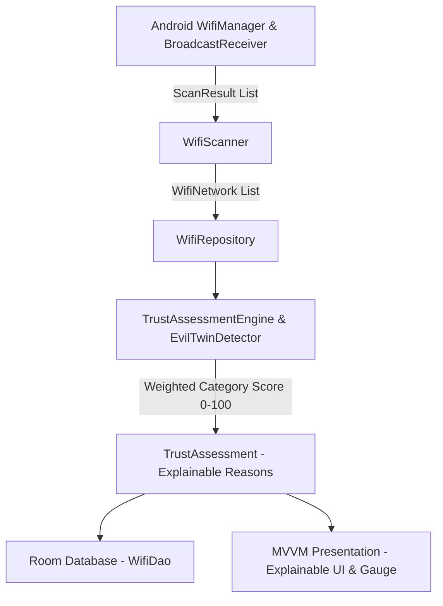
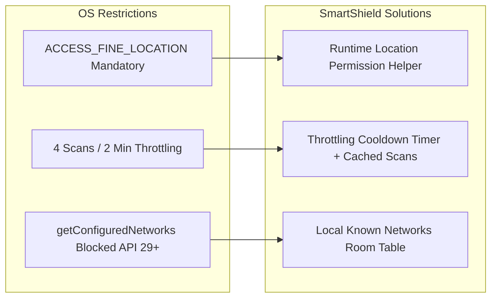
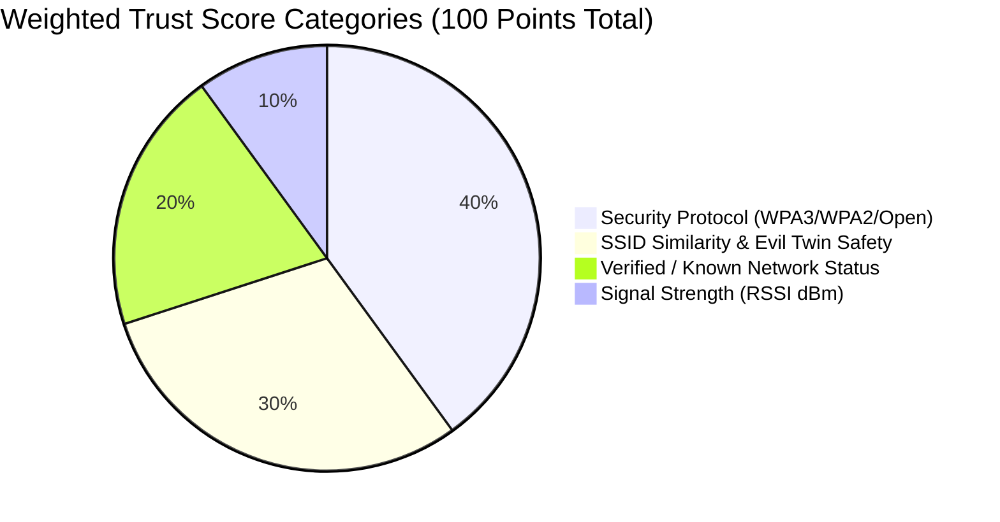
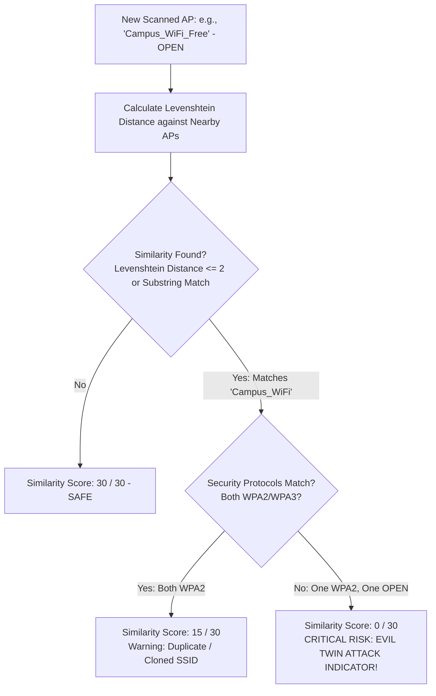
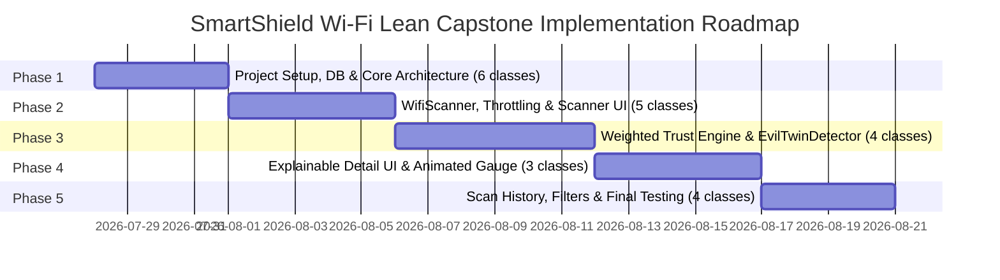

# SmartShield Wi-Fi: A Mobile Computing Framework for Wi-Fi Trust Assessment
## Final-Year B.Tech Mobile Computing Capstone Project — Architectural Design & Feasibility Report

---

## Executive Summary

**SmartShield Wi-Fi** is an explainable, rule-based mobile computing security framework designed for Android devices. Its primary objective is to empower users with real-time, explainable Wi-Fi trust evaluations before connecting to nearby wireless access points. Using official Android SDK APIs, a lean MVVM architecture (**22 core classes**), and a **Weighted Multi-Criteria Decision Assessment** engine, the application captures real-time radio spectrum metadata, evaluates potential security risks (including Evil Twin attacks via Levenshtein Distance and security protocol mismatches), and delivers an interactive **"Why should I trust this network?"** explanation.

> [!NOTE]
> **Viva Defense Note on "Intelligence" & Future Scope**  
> During your viva presentation, explain that the framework's intelligence derives from an **Explainable Rule-Based Expert System (XAI)** that combines multiple radio and security parameters into weighted decision categories. Under **Future Scope**, note that future versions can integrate machine learning models trained on real Wi-Fi datasets to further refine score weights.

---

## 1. Feasibility Analysis (Latest Android SDK — API 34 & 35)

### 1.1 Core Technical Feasibility
The project is **100% feasible** using the official Android SDK without root access. All capabilities—scanning nearby Wi-Fi networks, parsing encryption protocols, calculating weighted trust scores, detecting Evil Twin spoofing, and persisting scan history—are implemented using Android's `WifiManager`, `ScanResult`, and Room Database.



### 1.2 Android SDK API Compatibility Matrix

| Feature / Requirement | Android SDK API / Service | API Level Support | Architectural Solution |
| :--- | :--- | :--- | :--- |
| **Wi-Fi Discovery** | `WifiManager.startScan()` & `getScanResults()` | API 21+ (Restricted API 28+) | **Feasible** (`WifiScanner` with Throttling Cooldown) |
| **SSID & BSSID Retrieval** | `ScanResult.getWifiSsid()`, `ScanResult.BSSID` | API 33+ (`getWifiSsid()`), API 21+ (`SSID`) | **Feasible** (Backward-compatible string parser) |
| **Security Capabilities** | `ScanResult.getSecurityTypes()`, `capabilities` | API 30+ (Integer types), API 21+ (String parsing) | **Feasible** |
| **Signal Strength (RSSI)** | `ScanResult.level`, `WifiManager.calculateSignalLevel()` | API 21+ | **Feasible** |
| **Saved Network Detection** | `WifiManager.getConfiguredNetworks()` vs. Local DB | **Restricted API 29+** | **Feasible via SmartShield Known DB** |
| **Local Persistence** | Android Jetpack Room Database (`androidx.room`) | All supported API levels | **Feasible** |

---

## 2. Android API Limitations & Privacy Solutions



1. **Mandatory Location Permissions:** Any Android app retrieving Wi-Fi scan results (`BSSID`/`SSID`) must hold `ACCESS_FINE_LOCATION` and have Location Services enabled.
2. **Scan Throttling (4 Scans / 2 Minutes):** `WifiScanner` tracks scan timestamps and displays a visual cooldown countdown in the UI while serving cached results when throttled.
3. **API 29+ Configured Networks Restriction:** Third-party apps cannot access Android's system-wide saved networks. We overcome this by providing a local **SmartShield Known Networks Table** in Room Database where users can verify and trust networks.

---

## 3. Weighted Multi-Criteria Trust Assessment Engine

Instead of arbitrary flat points (`+20`, `-30`), SmartShield uses a professional **Weighted Multi-Criteria Decision Assessment (MCDA)** scoring model totaling **100 points** across 4 key security dimensions:

$$\text{Trust Score (0–100)} = \text{Security (40\%)} + \text{Similarity (30\%)} + \text{Known Status (20\%)} + \text{Signal (10\%)}$$



### 3.1 Weighted Category Breakdown

| Category | Max Weight | Scoring Matrix | Rationale |
| :--- | :--- | :--- | :--- |
| **1. Security Protocol** | **40 pts (40%)** | • **WPA3 / SAE:** `40 / 40`<br>• **WPA2-PSK:** `30 / 40`<br>• **WPA:** `15 / 40`<br>• **OPEN Network:** `0 / 40` | Encryption is the primary defense against eavesdropping and packet interception. |
| **2. SSID Similarity & Evil Twin Safety** | **30 pts (30%)** | • **No Similar SSIDs (Safe):** `30 / 30`<br>• **Similar SSID (Same Security):** `15 / 30` (Clone / Confusion)<br>• **Similar SSID + Mismatched Security:** `0 / 30` (CRITICAL EVIL TWIN RISK) | Prevents Evil Twin rogue APs from tricking users by spoofing legitimate network names. |
| **3. Known Network Status** | **20 pts (20%)** | • **Previously Verified in DB:** `20 / 20`<br>• **Unknown / New Network:** `10 / 20` | Rewards networks that the user has previously inspected and marked as safe. |
| **4. Signal Strength (RSSI)** | **10 pts (10%)** | • **Strong (>-65 dBm):** `10 / 10`<br>• **Moderate (-65 to -80 dBm):** `7 / 10`<br>• **Weak (< -80 dBm):** `3 / 10` | Extremely weak signals are more susceptible to packet drops and connection instability. |

### 3.2 Example Score Breakdown (Professional Viva Display)
- **Security Score:** `30 / 40` (WPA2-PSK)
- **Similarity Score:** `30 / 30` (No spoofing detected)
- **Known Status:** `20 / 20` (Verified in Room DB)
- **Signal Quality:** `8 / 10` (Strong RSSI -62 dBm)
- **Total Trust Score:** **`88 / 100` (SAFE)**

---

## 4. ⭐ Explainable Trust Assessment ("Why Should I Trust This Network?")

To deliver high academic and presentation impact, tapping any Wi-Fi network opens an **Explainable Trust Assessment Card** titled **"Why Should I Trust This Network?"**.

### Example 1: Safe WPA3 Network (Score: 100/100)
```markdown
### 🛡️ Why Should I Trust This Network?
- **[✓] WPA3 Enterprise/SAE Security (+40/40):** Uses state-of-the-art SAE wireless encryption.
- **[✓] No Similar Lookalike SSIDs (+30/30):** No nearby access points are imitating this network name.
- **[✓] Previously Verified in Registry (+20/20):** You marked this SSID/BSSID as trusted on July 25, 2026.
- **[✓] Strong Signal Quality (+10/10):** Excellent RSSI (-55 dBm) ensures stable communication.

**Final Assessment: 100 / 100 (SAFE)**
```

### Example 2: Evil Twin Rogue Access Point (Score: 8/100)
```markdown
### ⚠️ Why Should I Trust This Network?
- **[✗] OPEN Network - Unencrypted (+0/40):** No wireless encryption; traffic can be intercepted.
- **[✗] CRITICAL ALERT: Evil Twin Attack Detected (+0/30):** SSID (`"Campus_WiFi_Free"`) is highly similar to nearby WPA2 network (`"Campus_WiFi"`) but uses OPEN security!
- **[✗] Not Previously Verified (+0/20):** Unknown BSSID never before connected.
- **[✓] Strong Signal (+8/10):** Rogue AP is broadcasting at high power (-58 dBm).

**Final Assessment: 8 / 100 (HIGH RISK — DO NOT CONNECT)**
```

---

## 5. Evil Twin Detection Rule (Levenshtein + Security Mismatch)

SmartShield implements an advanced two-tier Evil Twin detector (`EvilTwinDetector`) combining **Levenshtein Distance** string metrics with **Security Protocol Comparison**:



- **Rule Logic:**
  $$\text{If } (\text{LevenshteinDistance}(\text{SSID}_1, \text{SSID}_2) \le 2) \text{ AND } (\text{Security}_1 \neq \text{Security}_2) \implies \text{CRITICAL EVIL TWIN ALERT}$$
- Why this impresses examiners: It demonstrates mathematical string algorithms (Levenshtein Distance) applied directly to a real-world cybersecurity threat (Evil Twin Rogue APs).

---

## 6. Lean 22-Class Architecture & Responsibility Inventory

To keep the architecture clean, student-friendly, and maintainable without unnecessary bloat, the entire project is structured into exactly **22 classes**:

```
com.smartshield.wifi/
├── SmartShieldApp.java
├── data/
│   ├── SmartShieldDatabase.java
│   ├── WifiDao.java
│   ├── WifiRepository.java
│   ├── KnownNetworkEntity.java
│   └── ScanHistoryEntity.java
├── domain/
│   ├── EvilTwinDetector.java
│   ├── TrustAssessment.java
│   ├── TrustAssessmentEngine.java
│   └── WifiNetwork.java
├── scanner/
│   ├── WifiScanner.java
│   └── WifiScanReceiver.java
├── presentation/
│   ├── main/
│   │   └── MainActivity.java
│   ├── scanner/
│   │   ├── ScannerFragment.java
│   │   ├── ScannerViewModel.java
│   │   └── WifiListAdapter.java
│   ├── detail/
│   │   ├── NetworkDetailActivity.java
│   │   └── NetworkDetailViewModel.java
│   ├── history/
│   │   ├── HistoryFragment.java
│   │   └── HistoryViewModel.java
│   └── customview/
│       └── TrustGaugeView.java
└── util/
    └── StringSimilarityUtil.java
```

### Complete Class Reference Table (22 Classes)

| # | Class Name | Architectural Layer | Complete Responsibility |
| :-: | :--- | :--- | :--- |
| 1 | `SmartShieldApp` | Core / Application | Initializes Room database and application-level dependency instance. |
| 2 | `SmartShieldDatabase` | Data / Local | Room database definition containing `WifiDao`. |
| 3 | `WifiDao` | Data / Local | Unified Room DAO for CRUD operations on both Scan History logs and Known/Trusted Wi-Fi networks. |
| 4 | `ScanHistoryEntity` | Data / Local | Table schema for historical scan assessments (`id`, `ssid`, `bssid`, `score`, `riskLevel`, `timestamp`, `reasonsJson`). |
| 5 | `KnownNetworkEntity` | Data / Local | Table schema for user-verified trusted networks (`ssid`, `bssid`, `addedTimestamp`). |
| 6 | `WifiRepository` | Data / Repository | Single source of truth coordinating `WifiScanner`, Room database persistence, and Known Network checks. |
| 7 | `WifiNetwork` | Domain / Model | Immutable domain model representing a discovered access point (SSID, BSSID, RSSI, Frequency, SecurityType). |
| 8 | `TrustAssessment` | Domain / Model | Holds the weighted score breakdown (`securityScore 40`, `similarityScore 30`, `knownScore 20`, `signalScore 10`), Total Score `0–100`, Risk Level, and list of explainable reasons. |
| 9 | `TrustAssessmentEngine` | Domain / Engine | Implements the Weighted Multi-Criteria scoring formula and generates the "Why Should I Trust This Network?" explanations. |
| 10 | `EvilTwinDetector` | Domain / Engine | Checks nearby access points for similar SSIDs with mismatched security protocols to flag Evil Twin attacks. |
| 11 | `WifiScanner` | Scanner / Hardware | Wraps Android's `WifiManager`, manages 4-scan/2-minute throttling cooldowns, and parses raw `ScanResult` lists. |
| 12 | `WifiScanReceiver` | Scanner / Hardware | `BroadcastReceiver` listening for system `SCAN_RESULTS_AVAILABLE_ACTION` broadcasts. |
| 13 | `MainActivity` | Presentation / UI | Main host activity holding bottom navigation (`ScannerFragment` & `HistoryFragment`). |
| 14 | `ScannerFragment` | Presentation / Scanner | Live Wi-Fi scan list screen with throttling timer, manual scan button, and risk filter chips. |
| 15 | `ScannerViewModel` | Presentation / Scanner | Exposes live UI state for scanned networks, handles scan refresh, and manages permissions. |
| 16 | `WifiListAdapter` | Presentation / Scanner | Material Design 3 card list adapter rendering Wi-Fi SSID, RSSI bars, security chips, and risk score badges. |
| 17 | `NetworkDetailActivity` | Presentation / Detail | The dedicated **Explainable Trust Assessment screen** displaying the animated Trust Score Gauge and "Why Should I Trust This Network?" checklist. |
| 18 | `NetworkDetailViewModel`| Presentation / Detail | Coordinates detailed assessment evaluation, toggles Known/Trusted network status in Room, and prepares security tips. |
| 19 | `HistoryFragment` | Presentation / History | Screen displaying historical scan logs saved in Room Database with filtering options. |
| 20 | `HistoryViewModel` | Presentation / History | Observes Room database logs and exposes sorted history to `HistoryFragment`. |
| 21 | `TrustGaugeView` | Presentation / Custom  | Custom animated Canvas view rendering a 0–100 color-graded arc (Green/Yellow/Red). |
| 22 | `StringSimilarityUtil` | Utility | Implements the Levenshtein Distance string metric algorithm used by `EvilTwinDetector`. |

---

## 7. Phased Implementation Roadmap



- **Phase 1: Project Setup & Room Database (6 classes):** `SmartShieldApp`, `SmartShieldDatabase`, `WifiDao`, `ScanHistoryEntity`, `KnownNetworkEntity`, `WifiRepository`.
- **Phase 2: Wi-Fi Discovery & Throttling (5 classes):** `WifiScanner`, `WifiScanReceiver`, `MainActivity`, `ScannerFragment`, `ScannerViewModel`, `WifiListAdapter`.
- **Phase 3: Weighted Trust Assessment Engine (4 classes):** `WifiNetwork`, `TrustAssessment`, `TrustAssessmentEngine`, `EvilTwinDetector`, `StringSimilarityUtil`.
- **Phase 4: Explainable UI & Decision Support (3 classes):** `NetworkDetailActivity`, `NetworkDetailViewModel`, `TrustGaugeView` (The "Why Should I Trust This Network?" experience).
- **Phase 5: History Persistence & Polish (4 classes):** `HistoryFragment`, `HistoryViewModel`, filter chips, and device testing on Android 14/15.
